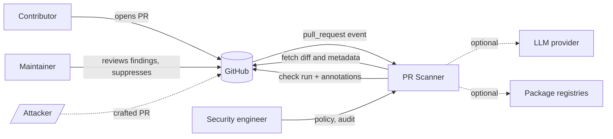

# 01 Stakeholders and Actors

## Primary (human) actors
| ID | Actor | Goal / interest |
|---|---|---|
| A1 | Maintainer | Merge safe PRs quickly; be warned about dangerous ones |
| A2 | Contributor | Get fast, clear feedback; not be falsely accused |
| A3 | Security engineer | Tune policy, review suppressions, audit scans |
| A4 | Rule author | Add and improve detection rules with confidence |
| A5 | Repo admin | Install, configure permissions, set blocking policy |

## Adversary actors
| ID | Adversary | Capability |
|---|---|---|
| X1 | External PR author | Submits crafted PRs, can iterate against scanner feedback |
| X2 | Compromised maintainer or bot account | Has write access, can change workflows and scanner config |
| X3 | Malicious dependency author | Publishes packages the PR pulls in |
| X4 | Scanner-aware evader | Knows the rules, designs payloads to slip past them |
| X5 | Prompt injector | Embeds instructions in PR content to manipulate the LLM layer |

## Secondary (system) actors
| ID | System | Interaction |
|---|---|---|
| S1 | GitHub platform | Delivers events, serves diffs, receives check runs and comments |
| S2 | LLM provider (optional) | Receives redacted snippets for triage context |
| S3 | Package registries (optional) | Metadata lookups for dependency reputation |
| S4 | CI runner | Hosts the Action |

## Stakeholder concerns
- Maintainers: low noise, low latency.
- Contributors: transparency, an appeal path via suppression review.
- Security: audit trail, no new attack surface.
- Organisation: data does not leave without opt-in (NFR-05).

## Context diagram

