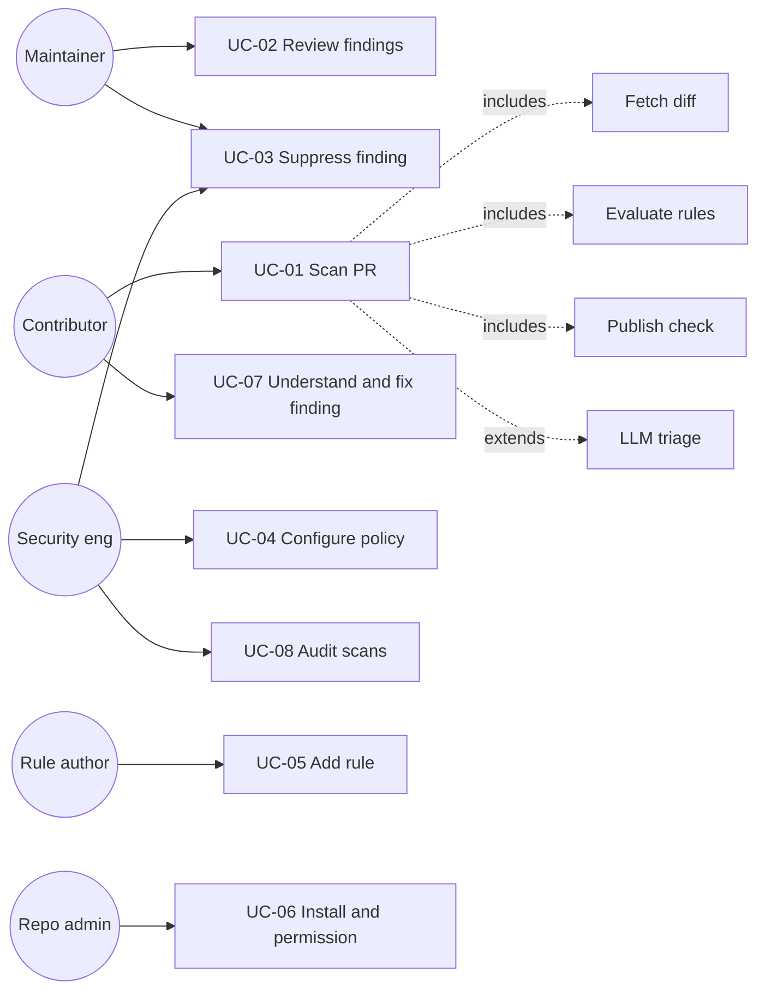

# 03 Use Cases

## Use case diagram

## UC-01 Scan a pull request
- **Actors:** Contributor (trigger), GitHub (S1)
- **Trigger:** PR opened / synchronized / reopened (FR-01)
- **Preconditions:** App or Action installed with permissions
- **Main flow:**
  1. Scanner receives event and validates it.
  2. Fetches PR metadata and diff via API (FR-02).
  3. Applies resource limits (NFR-06).
  4. Runs all enabled rules (FR-03..FR-08).
  5. Optionally requests LLM triage (FR-13).
  6. Computes verdict from findings (FR-14).
  7. Publishes check run and annotations (FR-09).
  8. Writes audit record (FR-15).
- **Alternate flows:**
  - A1: Diff exceeds limits, scan partial, verdict `warn: incomplete` (NFR-06).
  - A2: API failure, check concluded `failure`/`neutral` with reason (NFR-08).
  - A3: Config invalid, fail closed using safe default policy (FR-12).
- **Postcondition:** PR has a check with an explainable verdict.

## UC-02 Review findings
- **Actor:** Maintainer
- **Flow:** open check, read each finding (rule, evidence, rationale), decide: fix, request changes, suppress, or reject PR.
- **Requirements:** FR-10, NFR-12

## UC-03 Suppress a finding
- **Actors:** Maintainer or Security engineer
- **Flow:** mark finding as false positive, enter justification, system verifies authority, records it, re-evaluates verdict.
- **Alternates:** no justification gives rejection; unauthorised user gives rejection; suppression for a Critical-severity rule needs a Security engineer.
- **Requirements:** FR-11, FR-15

## UC-04 Configure policy
- **Actor:** Security engineer
- **Flow:** edit config (thresholds, enabled rules, allow-lists) via PR; the config change is itself scanned (FR-12) and requires CODEOWNERS approval.

## UC-05 Add a detection rule
- **Actor:** Rule author
- **Flow:** copy rule template, implement rule, add malicious and benign fixtures, run corpus metrics, open PR; CI enforces FR-16 and accuracy gate NFR-03.

## UC-06 Install and set permissions
- **Actor:** Repo admin
- **Flow:** install App/Action, grant minimal permissions (NFR-04), choose blocking vs advisory mode.

## UC-07 Understand and fix a finding
- **Actor:** Contributor
- **Flow:** read finding message, follow remediation, push fix, rescan passes. Alternate: dispute via maintainer (UC-03).

## UC-08 Audit scans
- **Actor:** Security engineer
- **Flow:** query audit records by repo, rule, suppression, time. Verify that rule versions and inputs are reproducible.

## Abuse / misuse cases
| ID | Misuse | Linked threat |
|---|---|---|
| MU-01 | Attacker crafts PR to evade rules | T-S01 |
| MU-02 | Attacker injects instructions into text the LLM reads | T-S02 |
| MU-03 | Attacker submits gigantic diff to time out the scan | T-S03 |
| MU-04 | Attacker edits scanner config or workflow to disable it | T-S06 |
| MU-05 | Attacker abuses suppression to silence a real finding | T-S07 |
| MU-06 | Attacker disputes the reviewer and creates a second account to vouch for the first (reported real incident) | T-S14, T-D15 |
