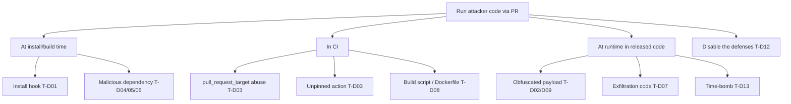
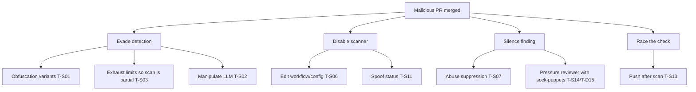

# 04 Threat Model

Two distinct models:
- **Part A:** attacks the scanner should *detect* in PRs (detection catalogue).
- **Part B:** attacks *against the scanner* (STRIDE).

Severity: C = Critical, H = High, M = Medium, L = Low. "Mitigation" refs point to requirements (02).

---
## Part A: Detection catalogue (what malicious PRs look like)

| ID | Attack class | Typical indicators | Sev | Covered by |
|---|---|---|---|---|
| T-D01 | Malicious install hook | New or changed `preinstall`/`postinstall`/`prepare`, `setup.py` cmdclass, build backend swap | C | FR-04 |
| T-D02 | Obfuscated / encoded payload | Long base64/hex, `eval(atob(...))`, `exec(b64decode(...))`, string-splitting, high entropy, minified code in src | H | FR-06 |
| T-D03 | CI workflow tampering | `pull_request_target` + checkout of PR head, `permissions: write-all`, new secret reads, unpinned third-party actions, `curl \| sh` | C | FR-05 |
| T-D04 | Dependency confusion / typosquat | New dep with name near a popular one; internal name on public registry | H | FR-07 |
| T-D05 | Lockfile tampering | Integrity hash changed without version change; resolved URL points elsewhere | H | FR-07 |
| T-D06 | Dependency swapped to remote source | Version replaced by git URL, tarball URL or raw IP | H | FR-07 |
| T-D07 | Credential theft / exfiltration | Read of env vars wholesale, `~/.ssh`, `~/.aws`, token files; outbound POST to new host | C | FR-08 |
| T-D08 | Build script / Makefile / Dockerfile abuse | New `RUN curl ... \| sh`, changed entrypoints, modified release scripts | H | FR-05, FR-06 |
| T-D09 | Hidden Unicode / trojan-source | Bidi control chars, homoglyph identifiers, zero-width chars | H | FR-06 |
| T-D10 | Unexpected binary | New executable or opaque blob in source tree | M | FR-06 |
| T-D11 | Account-takeover pattern | New or dormant account, sudden edits to workflows/release files | M | FR-17 |
| T-D12 | Scanner / policy disablement | Edits to scanner config, workflow, CODEOWNERS, branch protection files | C | FR-12 |
| T-D13 | Time-bomb / conditional payload | Date/host/CI-env-conditioned execution | M | FR-06, FR-08 |
| T-D15 | Sock-puppet endorsement / reviewer pressure | Author disputes a valid review concern; a newly created or low-history account appears to vouch for the author or approve the PR; coordinated comments, near-identical wording, similar timing. *Origin: real incident reported by project owner.* | H | FR-17, FR-18 |
| T-D16 | Remote binary dropper | Added code downloads a binary from a remote server and executes it (`urlretrieve`/`https.get`/`curl` plus `subprocess`/`child_process`/`exec.Command`/`chmod +x`); often from a raw IP. *Origin: real incident reported by project owner (approximate description, to be refined).* | C | FR-20 |
| T-D17 | CI-aware conditional execution | Code reads `CI`/`GITHUB_ACTIONS`/etc. and stays dormant under CI so automated checks see nothing, acting only on real machines. *Origin: same incident.* Static diff analysis is not fooled because the code is never run. | H | FR-20, FR-21 |
| T-D14 | Split payload across PRs or files | Benign fragments reassembled later | M | Out of scope v1; noted for roadmap (needs history analysis) |

### Attack tree: "Run attacker code in maintainers' or users' environment via a PR"

---
## Part B: Threats to the scanner (STRIDE)

### Trust boundaries
- TB1: GitHub PR content (untrusted) to Scanner
- TB2: Scanner to LLM provider (untrusted egress)
- TB3: Scanner to GitHub API (token-bearing)
- TB4: Repo config (semi-trusted, can be modified by PR)

| ID | STRIDE | Threat | Sev | Mitigation | Residual |
|---|---|---|---|---|---|
| T-S01 | Evasion (T/E) | Attacker tunes payload against known rules (encoding tricks, splitting, Unicode) | H | Layered rules, normalisation before matching, adversarial tests (NFR-11), keep some heuristics non-public | Accepted: determined adversary can evade; scanner is a layer, not a guarantee |
| T-S02 | Tampering | Prompt injection in diff/comments/PR body steers LLM to downplay | H | LLM optional; LLM cannot lower severity (FR-13); content delimited and treated as data; no tool access | Low |
| T-S03 | DoS | Huge diffs, regex catastrophic backtracking, zip bombs | M | Limits and timeouts, linear-time regex engine, partial result flagged `incomplete` (NFR-06) | Medium: the engine checks its time budget only *between* rules; a single rule stuck in a slow loop is not preempted yet. Planned: run rules in a subprocess/worker with a hard timeout (Phase 2). Until then rules must avoid unbounded regexes. |
| T-S04 | Elevation | Scanner executes PR code (import, build, `npm install`) | C | Never execute (NFR-01, ADR-0004); no checkout of PR head with secrets | Low |
| T-S05 | Info disclosure | Token or secrets leaked via logs, comments, LLM prompt, or `pull_request_target` misuse | C | Least privilege (NFR-04), log scrubbing, redaction, LLM opt-in (NFR-05); workflow runs from the base branch (`pull_request_target`) and never executes PR code; read-only scan job, separate `checks: write` job that validates the artifact as untrusted input (ADR-0005); tokens scrubbed from errors before truncation | Low |
| T-S06 | Tampering / Elevation | PR modifies scanner workflow/config to disable it | C | Config & workflow changes flagged (T-D12), CODEOWNERS, required status check set at repo/org level, config read from base branch not PR head | Medium: depends on repo settings |
| T-S07 | Repudiation / Tampering | Abuse of suppression; no record who silenced what | H | Justification + authority + audit (FR-11, FR-15) | Low |
| T-S08 | Spoofing | Forged webhook / event | M | Verify webhook signature; Action runs inside GitHub | Low |
| T-S09 | Tampering | Poisoned rule pack or compromised scanner dependency | C | Hash-locked deps, signed releases, SHA-pinned actions (NFR-10), rule changes need review | Medium |
| T-S10 | Info disclosure | Findings or audit leak private code snippets | M | Evidence truncation, access-controlled audit store | Low |
| T-S11 | Spoofing | Fake "scanner passed" status from another app/bot | M | Required checks bound to the scanner's app ID | Low |
| T-S12 | DoS | Attacker triggers false positives on rivals' PRs, creating alert fatigue | L | FP-rate gate (NFR-03), explainability, suppression path | Accepted |
| T-S14 | Spoofing / Tampering | Social pressure on maintainers: author or sock-puppet accounts dispute findings, or approve and suppress to wear down the reviewer | H | Findings are not clearable by comments or approvals; suppression needs an authorised, established user (FR-11); sock-puppet signals surfaced to maintainer (FR-18) | Medium: humans can still be persuaded |
| T-S13 | Tampering | Time-of-check/time-of-use: PR updated between scan and merge | M | Scan bound to head SHA; stale result invalid on `synchronize` | Low |

### Attack tree: "Get a malicious PR merged despite the scanner"

## Risk summary and next steps
- Top risks: T-S04, T-S05, T-S06, T-S09 (all Critical). Each is addressed by a design rule or ADR before any code.
- Review this model at every new rule class, integration, or incident.
- Seed Part A with real incidents and Sinan's own case once details are cleared for sharing.
