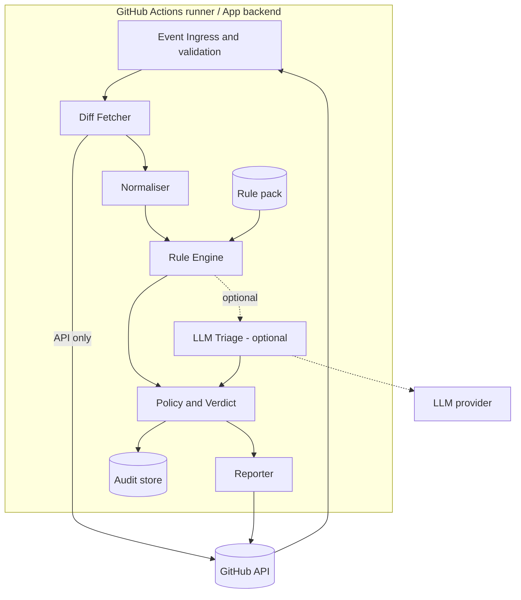
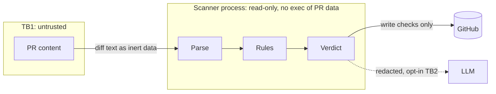
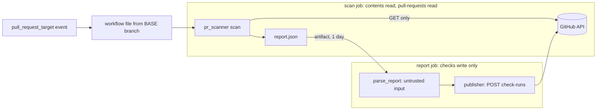

# 05 Architecture

## C4 Level 1: Context
See [01 Actors](01-stakeholders-actors.md#context-diagram).

## C4 Level 2: Containers

## Components
| Component | Responsibility | Key requirements |
|---|---|---|
| Event Ingress | Validate event/signature, map to ScanRequest | FR-01, T-S08 |
| Diff Fetcher | Pull diff and metadata via API (`github_client.py`, `fetcher.py`); diff requested by immutable base...head SHAs; enforce size limits; incomplete results are flagged, never empty | FR-02, NFR-06 |
| Normaliser | Decode, strip/flag Unicode tricks, classify file type, extract added lines | T-D09, T-S01 |
| Rule Engine | Run rules in isolation; collect Findings. The time budget is checked between rules, **per-rule timeout not built yet** (T-S03) | FR-03, NFR-07 |
| Rule pack | Rules grouped by domain: hooks, ci, obfuscation, deps, exfil (built: hooks, dropper, ci, obfuscation, scanner; **not built:** deps, exfil) | FR-04..08 |
| Policy and Verdict | Severity to verdict; suppressions; config | FR-11, FR-12, FR-14 |
| LLM Triage | Optional, redacted context only; cannot lower severity | FR-13, T-S02 |
| Reporter | Check run, annotations, summary (`reporter.py`): all PR-derived text escaped, hidden characters shown as markers, size caps | FR-09, FR-10, T-S05 |
| Report hand-over | `report_io.py` serialises the report and validates it as untrusted input in the privileged job (closed schema, limits, event SHA wins, Markdown invariants re-checked) | ADR-0005 |
| Publisher | `publisher.py`: the only write path, one endpoint, no retry, token never in output | NFR-04, NFR-08 |
| CLI | `cli.py`: `scan` (unprivileged) and `report` (privileged); every failure becomes an ERROR report | NFR-08 |
| Real-world runner | `realworld.py`: samples merged PRs, scans them, reports outcome rates with intervals (measurement tool, not part of the Action) | NFR-03 |
| Audit store | Append-only scan records | FR-15 |

## Data flow and trust boundaries

## Key design rules
1. PR data is **inert text**: never passed to `eval`, shell, import, package manager or template engines.
2. Config and rules are read from the **base branch**, not the PR head, so a PR cannot weaken its own scan (T-S06).
3. Results are bound to the **head SHA** (T-S13).
4. Privileged operations (posting checks) are separated from analysis; analysis has a read-only token. The two run as separate jobs and the privileged job treats the analysis job's output as untrusted (ADR-0005).
5. Every rule is a pure function: `(NormalisedDiff, Context) -> list[Finding]`.
6. Failures never become a pass: engine errors, fetch errors, a moved head, a missing or rejected report all map to a failing or `action_required` check (NFR-08). `INCOMPLETE` is `action_required`, `BLOCK` and `ERROR` are `failure`, `WARN` is `neutral`.
7. The workflow runs from the **base branch** (`pull_request_target`) so a PR cannot edit or disable it, and it never checks out or runs PR code. A merged change to the workflow, `.pr-scanner.yml` or CODEOWNERS is flagged by `SCANNER-TAMPER` and held by CODEOWNERS plus branch protection.
8. Everything shown to a human or to GitHub that came from a PR is escaped first, and hand-written reports are rejected.

## Deployment
**v1 (built, ADR-0005):** a GitHub Actions workflow in the repository, triggered by `pull_request_target` so GitHub runs the file from the base branch. Two jobs:

A missing, unreadable or rejected `report.json` becomes a fixed failing check on the event's commit. Only the check named **"PR scanner"** should be required in branch protection (`docs/branch-protection.md`).

**Rejected alternative:** `pull_request` plus a `workflow_run` reporter. The PR's own workflow file runs in that design, so a PR can forge the artifact the privileged job trusts.

**Later:** a GitHub App for org-wide installs, central audit and suppressions. Not built.
