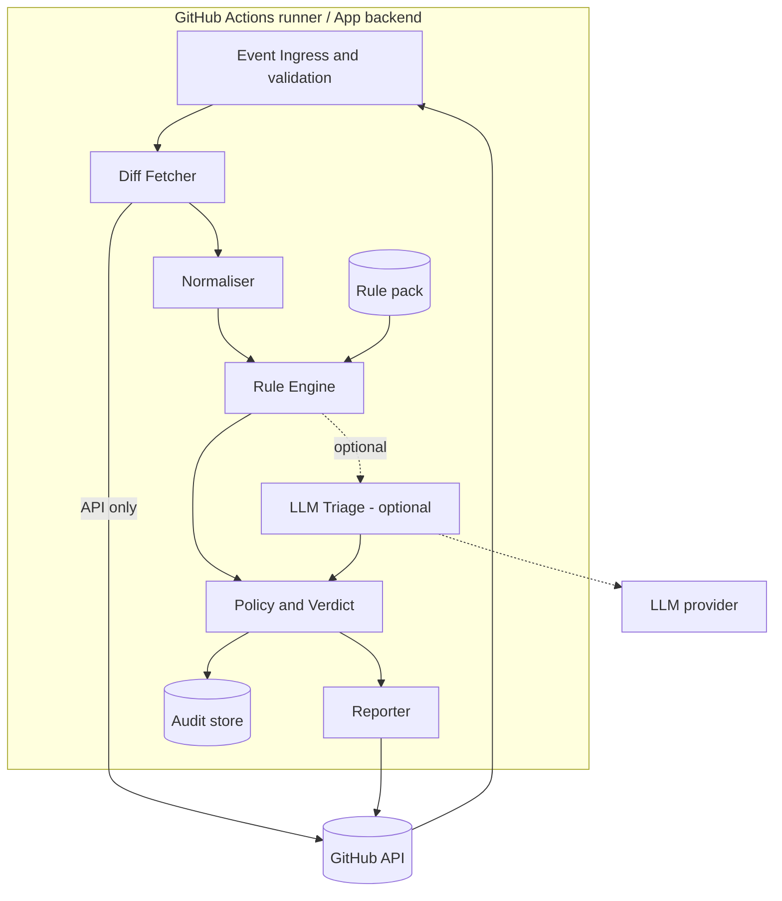
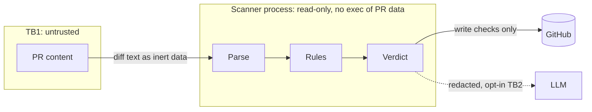

# 05 Architecture

## C4 Level 1: Context
See [01 Actors](01-stakeholders-actors.md#context-diagram).

## C4 Level 2: Containers

## Components
| Component | Responsibility | Key requirements |
|---|---|---|
| Event Ingress | Validate event/signature, map to ScanRequest | FR-01, T-S08 |
| Diff Fetcher | Pull diff and metadata via API; enforce size limits | FR-02, NFR-06 |
| Normaliser | Decode, strip/flag Unicode tricks, classify file type, extract added lines | T-D09, T-S01 |
| Rule Engine | Run rules in isolation with per-rule timeout; collect Findings | FR-03, NFR-07 |
| Rule pack | Rules grouped by domain: hooks, ci, obfuscation, deps, exfil | FR-04..08 |
| Policy and Verdict | Severity to verdict; suppressions; config | FR-11, FR-12, FR-14 |
| LLM Triage | Optional, redacted context only; cannot lower severity | FR-13, T-S02 |
| Reporter | Check run, annotations, summary | FR-09, FR-10 |
| Audit store | Append-only scan records | FR-15 |

## Data flow and trust boundaries

## Key design rules
1. PR data is **inert text**: never passed to `eval`, shell, import, package manager or template engines.
2. Config and rules are read from the **base branch**, not the PR head, so a PR cannot weaken its own scan (T-S06).
3. Results are bound to the **head SHA** (T-S13).
4. Privileged operations (posting checks) are separated from analysis; analysis has a read-only token.
5. Every rule is a pure function: `(NormalisedDiff, Context) -> list[Finding]`.
6. Failures propagate as explicit `ScanError`, mapped to a non-success check (NFR-08).

## Deployment options
- **v1:** GitHub Action (composite/Docker), runs on `pull_request`; forks get read-only token and a separate `workflow_run` job posts sanitised results.
- **Later:** GitHub App service for org-wide installs and central audit.
