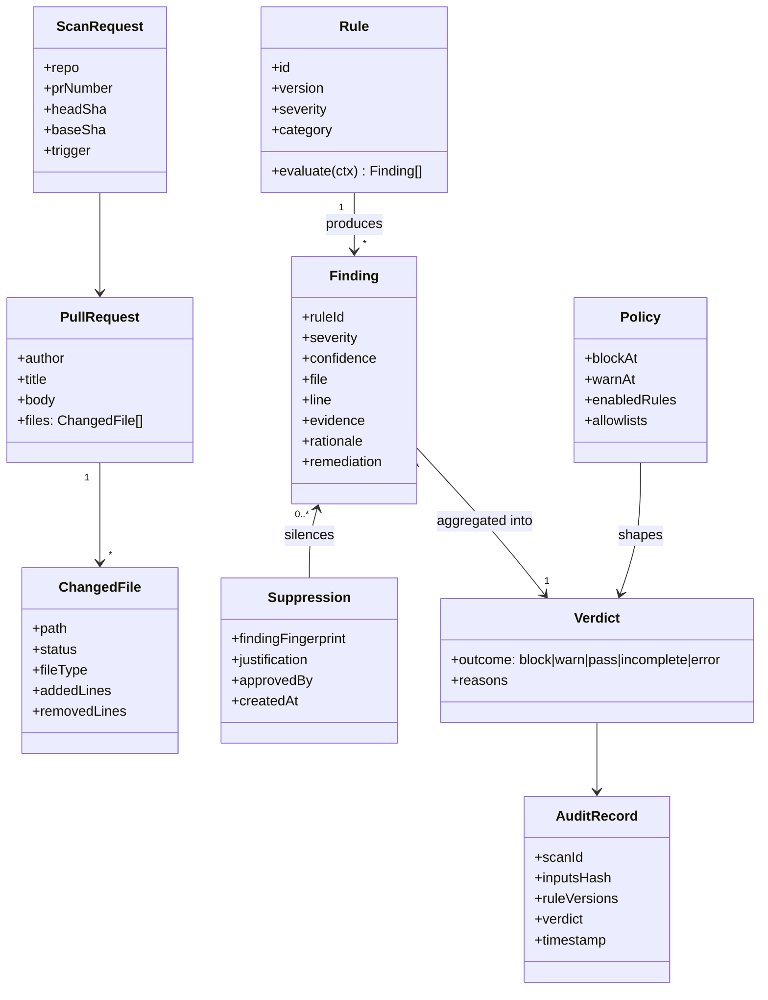

# 06 Domain Model

## Severity and verdict mapping (default policy)
| Highest unsuppressed severity | Verdict |
|---|---|
| Critical | `block` |
| High | `block` (configurable to `warn`) |
| Medium | `warn` |
| Low / none | `pass` |
| Partial scan (limits hit) | `incomplete` (treated as `warn` minimum) |
| Internal error | `error` (check failure, never success) |

## Invariants
- A Finding always has non-empty rule ID, evidence, rationale, remediation (FR-10).
- A Suppression requires justification and an authorised approver (FR-11).
- Verdict is a pure function of (findings, suppressions, policy): deterministic (NFR-07).
- LLM-derived annotations can raise, never lower, severity (FR-13).
